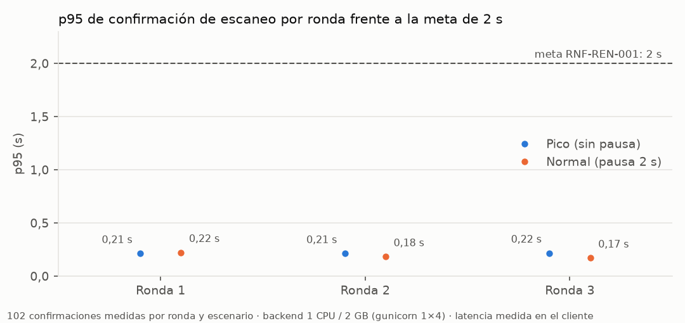
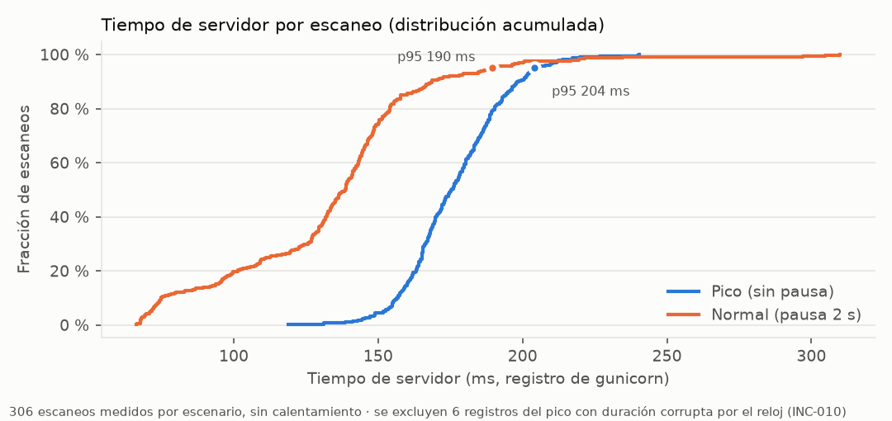
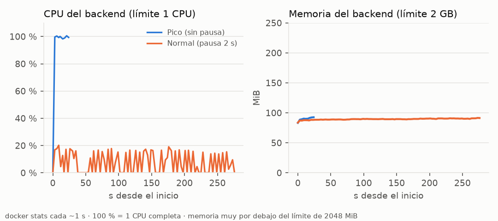
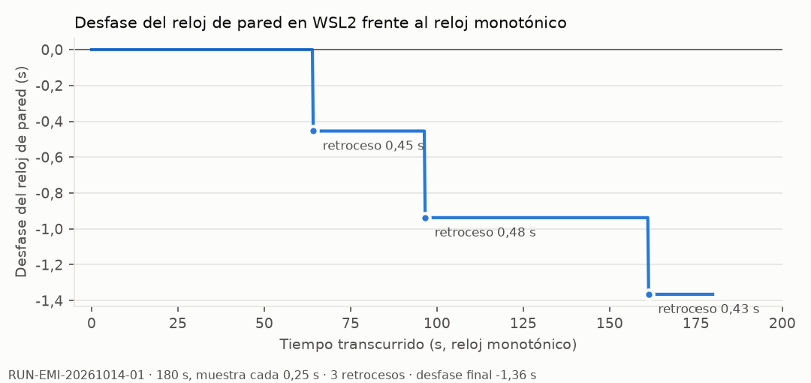

# Informe de rendimiento del escaneo de asistencia

Responsable: Emilio. Ejecución técnica asistida por Claude Code; revisión de Daniel y Pablo pendiente.
Fecha: 15 de octubre de 2026 (America/Guatemala). Corridas `RUN-EMI-20261015-01` (pico) y `RUN-EMI-20261015-02` (normal).
Requisitos de referencia: RNF-REN-001 (p95 ≤ 2 s desde la lectura hasta la confirmación, sobre 1 vCPU / 2 GB) y RNF-REN-002 (tasa pico de operadores).

## Conclusión

Con el backend limitado al perfil objetivo de 1 CPU y 2 GB, el endpoint de escaneo confirmó 612 de 612 escaneos medidos, sin errores ni eventos perdidos, con un p95 entre 170 y 222 ms en las seis rondas: unas diez veces por debajo de la meta de 2 s. El cuello de botella es la CPU: sin pausa entre escaneos, el backend trabaja al 100 % de su CPU y entrega unos 16 escaneos por segundo; con un ritmo de portón realista usa en promedio el 7,5 %. La memoria no pasa de 93 MiB de 2048.

Esto cumple el protocolo del plan para la API. **No acredita RNF-REN-001 completo**: falta medir la confirmación visual en un teléfono real con TLS, y la cantidad de operadores (3) sigue siendo la referencia provisional hasta que la institución responda PD-010.

## Resultados

| Escenario | Ronda | Confirmados | Error | Throughput | p50 | p95 | p99 | Máx |
| --- | --- | ---: | ---: | ---: | ---: | ---: | ---: | ---: |
| Pico (sin pausa) | 1 | 102 / 102 | 0 % | 16,6 /s | 176 ms | 213 ms | 226 ms | 244 ms |
| Pico (sin pausa) | 2 | 102 / 102 | 0 % | 16,3 /s | 182 ms | 212 ms | 223 ms | 227 ms |
| Pico (sin pausa) | 3 | 102 / 102 | 0 % | 15,8 /s | 187 ms | 217 ms | 230 ms | 244 ms |
| Normal (pausa 2 s) | 1 | 102 / 102 | 0 % | 1,39 /s | 153 ms | 222 ms | 308 ms | 313 ms |
| Normal (pausa 2 s) | 2 | 102 / 102 | 0 % | 1,40 /s | 143 ms | 183 ms | 200 ms | 204 ms |
| Normal (pausa 2 s) | 3 | 102 / 102 | 0 % | 1,42 /s | 100 ms | 170 ms | 192 ms | 195 ms |

Latencia medida en el cliente con reloj monotónico (`time.perf_counter`), desde el envío de la petición hasta recibir la confirmación. Cada ronda tuvo además 30 escaneos de calentamiento (10 por operador), excluidos de los percentiles; ninguno falló ni se perdió.

### Tiempo dentro del servidor

El registro de gunicorn guarda la duración de cada petición dentro del backend, sin red ni cliente. Sobre los 306 escaneos medidos de cada escenario:

| Escenario | p50 | p95 | p99 | Máx | Registros excluidos |
| --- | ---: | ---: | ---: | ---: | ---: |
| Pico | 175 ms | 204 ms | 220 ms | 240 ms | 6 |
| Normal | 139 ms | 190 ms | 235 ms | 310 ms | 0 |

Casi toda la latencia del cliente es tiempo del servidor; la red local entre contenedores aporta pocos milisegundos.

Los 6 registros excluidos del pico muestran duraciones de unos 86 399 s (un día menos medio segundo). gunicorn calcula la duración con el reloj de pared, y el reloj de WSL2 retrocedió durante esas peticiones (INC-010): la resta dio negativa y se presentó como casi un día. Son dos ráfagas de tres peticiones concurrentes, una por cada retroceso. Su duración real no se conoce, por lo que se excluyen de esta tabla. La latencia del cliente no se ve afectada porque usa un reloj monotónico, y esas 6 peticiones sí se confirmaron.

### Recursos

| Escenario | Contenedor | CPU media | CPU máx | Memoria máx | Muestras |
| --- | --- | ---: | ---: | ---: | ---: |
| Pico | backend (límite 1 CPU / 2 GB) | 99,6 % | 100,5 % | 92,7 MiB | 9 |
| Pico | PostgreSQL (sin límite) | 40,5 % | 53,6 % | 116,8 MiB | 9 |
| Normal | backend (límite 1 CPU / 2 GB) | 7,5 % | 20,2 % | 91,6 MiB | 93 |
| Normal | PostgreSQL (sin límite) | 3,8 % | 32,5 % | 116,5 MiB | 93 |

100 % equivale a una CPU completa. En el pico, el backend usa toda la CPU disponible durante la carga: el throughput de unos 16 escaneos por segundo es el máximo de este perfil, no una tasa esperada en el portón. El escenario pico tiene pocas muestras de recursos porque cada ronda dura unos 6 s.

## Entorno y procedimiento

| Elemento | Valor |
| --- | --- |
| Código | `a26753a9e978`: `develop` (`8a700e1`) más la corrección del seed de demostración, que no toca el camino del escaneo |
| Backend | Imagen `Dockerfile.cloud` (la de QA en la nube): gunicorn, 1 worker × 4 threads, `--cpus 1 --memory 2g` (verificado en `backend-limits.txt`) |
| Configuración Django | `config.settings.development` con `DJANGO_DEBUG=false`: los ajustes de nube fuerzan cookies seguras y un cliente HTTP local perdería la sesión |
| Base de datos | PostgreSQL 16.11 en tmpfs, sin límite (en la nube es Cloud SQL, separado del backend) |
| Datos | `scripts/quality/load/seed_scan_load.py`: 3 operadores sintéticos y 450 estudiantes con matrícula activa |
| Carga | `scripts/quality/load/scan_load_test.py` (#573): `--rounds 3 --operators 3 --requests-per-operator 34 --warmup 10`; normal con `--think 2.0` |
| Cliente | Contenedor aparte en la misma red Docker, sin límite de recursos |
| Recursos | `docker stats` cada ~1 s |
| Host | Windows con WSL2 (kernel 6.18.33.2) y Docker Desktop |

El script completo y repetible está en la carpeta de evidencia de cada corrida (`run_perf.sh`); crea una red y contenedores desechables y no toca el entorno de desarrollo. Las gráficas se generan con `graficas.py` desde los mismos archivos.

El primer intento del pico no llegó a medir: Django 5.2 imprime «74 objects imported automatically» en la salida de `manage.py shell` antes del JSON de la siembra, y la herramienta no pudo leerlo. Se conservó en `intento-1/`. El README de `scripts/quality/load` usa el mismo comando, por lo que tiene el mismo problema; queda como observación para Daniel.

## Desfase del reloj en WSL2 (INC-010)

Una segunda medición del reloj el 14 de octubre (`RUN-EMI-20261014-01`, 180 s, muestra cada 0,25 s) registró 3 retrocesos del reloj de pared de 0,45, 0,48 y 0,43 s, con un desfase final de −1,36 s frente al reloj monotónico. Confirma, en un segundo día, la causa de INC-010 identificada el 13 de octubre. En esta medición de carga se observó el mismo efecto en los registros de gunicorn.

## Límites

- Mide la API, no la confirmación visual en pantalla: faltan el teléfono, la cámara y el TLS reales.
- El cliente y el backend comparten el mismo equipo y red local; en producción se suma la red del establecimiento.
- 3 operadores es la referencia provisional; la tasa pico institucional (PD-010) sigue sin confirmar.
- El calentamiento se expresa en escaneos (10 por operador), no en los 2 minutos del plan; la herramienta no admite tiempo.
- La base de datos no tuvo límite de recursos.
- No sustituye una medición en QA en la nube ni la aceptación institucional.

## Evidencia

Artefactos locales en `docs/quality/fase-7/evidence/RUN-EMI-20261015-01/`, `RUN-EMI-20261015-02/` y `RUN-EMI-20261014-01/`, ignorados por Git. Hashes en [evidencias.md](evidencias.md).
